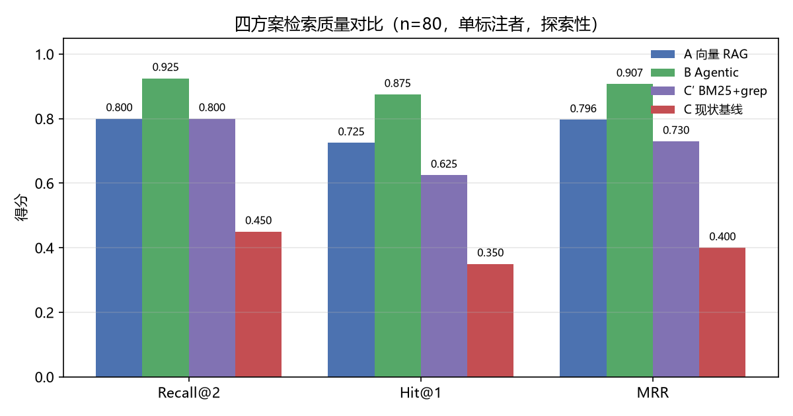
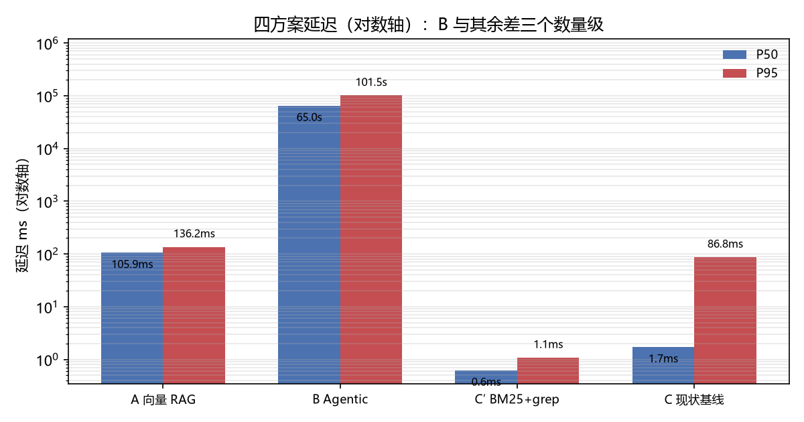

<div align="center">


# Embedded AI Master

**面向嵌入式调试的 agent 工作台**

用一个能读懂工程、能操作探针、能查故障库和数据手册的 agent，替代「翻手册 → 猜原因 → 反复试」的排查循环。

[](https://github.com/mogenga/Embedded-Ai-Master/releases)
[](https://github.com/mogenga/Embedded-Ai-Master/releases/latest)
[](LICENSE)
[](https://nodejs.org)

[下载](#下载) · [能做什么](#能做什么) · [快速开始](#快速开始) · [文档地图](#文档地图)

</div>

---

## 目录

- [下载](#下载)
- [能做什么](#能做什么)
- [技术栈](#技术栈)
- [工作方式](#工作方式)
  - [一次诊断怎么走](#一次诊断怎么走)
  - [检索层怎么选型](#检索层怎么选型)
- [快速开始](#快速开始)
- [目录结构](#目录结构)
- [配置](#配置)
- [命令](#命令)
- [内置工具](#内置工具)
- [MCP 客户端](#mcp-客户端)
- [权限与审批](#权限与审批)
- [上下文压缩](#上下文压缩)
- [系统提示词](#系统提示词)
- [会话](#会话)
- [领域 MCP](#领域-mcp)
- [工具链包管理器](#工具链包管理器)
- [桌面工作台](#桌面工作台)
- [语料 OTA](#语料-ota)
- [验证边界](#验证边界)
- [已知限制](#已知限制)
- [文档地图](#文档地图)

## 下载

最新版 **v0.3.1**（2026-11-09）：Windows x64 NSIS 安装包，在 [Releases](https://github.com/mogenga/Embedded-Ai-Master/releases/latest) 页。该版本新增**只读子代理**（`subagent` / `subagent_check`，运行条可见、点开只读回放）、**外部命令钩子**（`hooks.json`，`/hook` 可查）与 BR-7 夜批管线；移除顶部事件回放控件；修复宿主完成事件从不落盘（D-230）与空 `@` 不显示文件。v0.3.1 修掉任务栏图标不是应用图标、侧栏多出安装目录那个工作区、当前会话删不掉。详见 release 说明。

> [!WARNING]
> **安装包未做代码签名。** 首次运行 Windows 会显示「未知发布者」的 SmartScreen 提示——点「更多信息」→「仍要运行」。这是缺少签名证书所致（见 [`docs/operations/code-signing.md`](docs/operations/code-signing.md)），不是文件损坏。未签名构建里，应用内更新下载到的包也不做签名校验。

## 能做什么

| 能力 | 说明 |
|---|---|
| **接真实硬件** | 经 MCP 挂载探针后端：Renode 仿真、已运行的 OpenOCD。读写内存、复位、串口收发都要先声明。探针 server 需手工接入，见[领域 MCP](#领域-mcp) |
| **驱动 Keil 工具链** | Keil uVision（UVSOCK），调试 57 个动作、工程 14 个动作。只驱动本机已装的 MDK，不下载不捆绑 |
| **查本地故障库** | 108 篇嵌入式调试语料 / 90 条索引，首跳加多轮检索 |
| **查数据手册** | 工作区里的芯片 PDF：混合排序检索、整页读取、寄存器表启发式提取。依赖 `pdftotext` |
| **桌面诊断工作台** | 会话、串口助手、产物面板与单文件预览、知识库、工具链包管理、计划条、托盘与应用内更新 |
| **权限与审批** | 四档预设，写操作逐次审批，决策写入会话日志 |
| **语料 OTA** | Ed25519 签名保证完整性；不自动应用，用户确认才下载 |

**它不做的事**

- 不代替人做安全判断：探针写内存前必须声明意图。
- 不猜故障：全 0 读数只报警告，不推断「无故障」。
- 不伪造能力：前端没有的内核能力就隐藏入口，不画假按钮。

工具链只保 Keil 一条链路。CubeIDE / ESP-IDF / Arduino 三套后端已于 2026-10-25 移除，不会出现在界面或工具列表里。

## 技术栈

| 层 | 选型 |
|---|---|
| 语言与运行时 | TypeScript，Node.js ≥ 24，ESM-only |
| 协议 | MCP 官方 TS SDK v2（客户端 / server / stdio 传输） |
| 校验与测试 | Zod v4，Vitest v4 |
| 前端 | 纯 ES 模块，无框架、无打包器、无构建步骤，由 Electron 承载 |
| 实时通道 | 行分隔 JSON over stdio（桌面宿主 ⇄ 渲染器） |
| 串口 | 面板侧用 `serialport` 13（原生模块）；agent 侧临时捕获走 PowerShell |

打包用的是 `desktop/` 声明的 Electron 44，根 `package.json` 声明 45，两者尚未统一。

## 工作方式

### 一次诊断怎么走

一次会话的执行体是一台**循环**：模型回复 → 若有工具调用就执行并回填结果 → 再问模型，直到模型不再调用工具为止。循环里只有两个续跑点：上下文超限时先压缩再继续，输出被截断时让模型接着写。

四个设计取舍：

| 决策 | 做法 | 为什么 |
|---|---|---|
| **状态机即循环** | 循环本身就是状态机，轮次状态由会话日志承载 | 日志即真相：进程崩了重放日志就能恢复，不必再序列化一个状态机 |
| **续跑点只有两个** | 上下文超限、输出被截断 | 更多续跑点依赖服务端专有特性，OpenAI 兼容协议下并不存在 |
| **取消一条线贯穿** | 一次取消贯穿模型请求、工具执行与 MCP 子进程 | 嵌入式串口是长读，用户取消必须立刻生效，不能等超时 |
| **批内只读并行** | 模型一次声明的多个调用为一批；只读的并行，含写操作的整体串行 | 更激进的调度是给几十上百个工具设计的，内置 12 个加 MCP 的规模下收益不抵复杂度 |

同一条循环喂给两种形态，差别只在事件流的消费者：**headless CLI** 与**桌面工作台**。这就是「一次诊断的日志能被原样回放」的结构基础。

细节见 [`docs/specs/p0-kernel-design.md`](docs/specs/p0-kernel-design.md)。

### 检索层怎么选型

**问题**：本地故障库检索该用向量 RAG，还是让 agent 自己多轮检索？

2026-10-21 跑了一轮对照实验：四方案、80 条自建查询、单标注者。完整报告在 [`experiments/rag-vs-agentic-search/`](experiments/rag-vs-agentic-search/docs/experiment-report.md)。

| 方案 | Recall@2 | Hit@1 | MRR | P50 | P95 | 失败率 |
|---|---|---|---|---|---|---|
| **B Agentic search**（多轮检索 + 读原文） | **0.925** | **0.875** | **0.907** | 65.0 s | 101.5 s | 2.5% |
| A 向量 RAG | 0.800 | 0.725 | 0.796 | 106 ms | 136 ms | 0% |
| C′ BM25 + 精确检索 | 0.800 | 0.625 | 0.730 | **0.6 ms** | **1.1 ms** | 0% |
| C 现状基线 | 0.450 | 0.350 | 0.400 | 1.7 ms | 87 ms | 15% |





两张图由实验脚本从 `results/scored/main/overall.csv` 直接生成，不手录数字。

**三条结论**：

1. **维持无 RAG** —— 不引入向量召回层。理由比原计划更强：不是「向量方案没赢稀疏方案」（两者完全打平），而是 **agentic 检索显著优于向量检索**（高 12.5 个百分点，校正后 p = 0.039）。
2. **「廉价首跳 + 精确检索」这条路值得走** —— 实验里的 C′ 显著优于现状基线（高 35.0 个百分点）。产品落地形态是**索引首跳加多轮检索**，不是实验里那个 BM25 实现。
3. **B 的代价决定它只能离线跑** —— P95 101.5 秒，每条约 1.9 万输入 token。产品**没有**实现这条链路：多轮检索是模型在交互回合里自己发起的，不等同于 B。

| | 交互链路（已部署） | 离线批量（仅实验） |
|---|---|---|
| **选谁** | 索引首跳 + 检索循环 | B Agentic search |
| **延迟** | 首跳毫秒级 | P95 101.5 s |
| **Recall@2** | 未在本部署协议下测量 | 0.925 |

**部署形态与实验形态必须分开说**：实验里的 B 没有索引首跳，所以 **B 的成绩不能当作本部署的成绩**；B 的 KB 外查询拒答也未评估。缺口登记在 D-179。

**B 的优势不来自评测集与语料同源** —— 已用覆盖率分层排除：低覆盖层高 18.8 个百分点、高覆盖层高 23.5 个百分点，相关系数 −0.018；对照组的词频红利形态（低覆盖层 −12.5 个百分点）没有出现在 B 上。

> [!NOTE]
> **这是探索性结果，不是确认性结论。** 预注册未冻结哈希，确认性评测拒绝执行；样本 80 条（原设计 274 条），单标注者、无一致性系数。**方向已关闭，决策点未关闭** —— 剩余缺口见 [`docs/ledgers/rag-vs-agentic-search-todo.md`](docs/ledgers/rag-vs-agentic-search-todo.md) §7.4。

## 快速开始

### 从源码跑

```bash
npm install                 # 依赖（由你执行，本仓库的 agent 不代为安装）
npm run build               # 内核
npm run build:mcp           # 领域 MCP server
npm test                    # 全量测试（不触网）
```

桌面形态：

```bash
npm --prefix desktop install   # 一次性
npm --prefix desktop run desktop
```

### headless 跑一次

需要一个 OpenAI 兼容网关：

```bash
HARNESS_COMPAT_MODEL=<provider>/<model> node dist/demo/run.js "读取平台信息后结束"
```

| 变量 | 说明 |
|---|---|
| `HARNESS_COMPAT_MODEL` | 必填，`<provider>/<model>` |
| `HARNESS_HOME` | harness 数据目录 |
| `HARNESS_COMPAT_BASE_URL` | 可选，覆盖服务地址 |
| `HARNESS_COMPAT_API_KEY_ENV` | 可选，覆盖密钥环境变量名 |

退出码：`0` 正常完成 / `1` 熔断或非正常收尾 / `130` 取消 / `2` 用法或装配错误。密钥来自 `HARNESS_COMPAT_API_KEY_ENV` 指向的环境变量，也可以直接写进配置。

## 目录结构

```
src/                 内核（平台层，不含领域逻辑）
├── config/          配置文件加载
├── context/         上下文投影、预算与分级压缩
├── corpus/          语料 OTA：验签、快照、更新、首次种子化
├── demo/            headless CLI 入口
├── events/          会话日志跟随
├── loop/            主循环、事件类型、熔断、流式写入
├── mcp/             MCP 客户端：配置合并、生命周期、工具适配
├── model/           模型适配器、重试、token 估算、服务探测
├── permissions/     规则匹配、预设、审批与审计
├── packs/           工具链包管理器
├── server/          宿主库层：会话运行器、审批桥、会话管理、KB 定位、文件 API
├── session/         只追加的分代事件日志
├── skills/          技能存储
├── tools/           工具契约与注册表、内置工具、执行管线
└── index.ts         会话装配
mcp-servers/         领域 MCP server（probe / kb / serial / keil / datasheet）
desktop/
├── main.js          Electron 主进程
├── preload.cjs      contextBridge 桥
├── host/            宿主进程：命令分发、工作区、串口桥、工具链探测
├── renderer/        纯 ES 模块前端
└── MATRIX.md        前端命令/事件能力矩阵
scripts/             端到端脚本与发布工具
config/              随包默认配置与模板
experiments/         RAG 对照实验资产（Python，不进 npm 测试）
tests/               Vitest（tests/desktop 为桌面宿主与协议层）
docs/                设计、契约与已知问题
```

## 配置

全部配置都在 `$HARNESS_HOME` 下，缺省 `%USERPROFILE%/.harness`（Windows）或 `~/.harness`。

| 文件 | 内容 |
|---|---|
| `providers.json` | 模型服务：协议、地址、密钥、模型、超时、响应上限、价格 |
| `mcp.json` | MCP server 定义：命令、参数、环境、超时 |
| `permissions.json` | 权限预设、规则、审批超时 |
| `run.json` | 轮数上限、成本上限、超时、系统提示词、推理强度 |
| `corpus.json` | 语料 OTA 的桶地址与公钥 |

一个模型服务的形状：

```json
{
  "local-gw": {
    "protocol": "openai-chat-completions",
    "baseUrl": "http://127.0.0.1:8080/v1",
    "apiKey": "sk-…",
    "apiKeyEnv": "LOCAL_GW_KEY",
    "models": {
      "flash": {
        "contextWindow": 128000,
        "maxOutput": 8192,
        "supportsReasoning": true,
        "reasoningEffort": "medium"
      }
    },
    "requestTimeoutMs": 120000,
    "maxResponseBytes": 8388608,
    "pricePerMillion": { "input": 1, "output": 1, "cachedInput": 0.1 }
  }
}
```

**密钥**

- 优先用直接填写的密钥，其次用环境变量名指向的值。
- 两者都拿不到非空值就**不发**鉴权头，本地网关可以空跑。空字符串等于没填。
- 直接填写的密钥以明文存在本机配置文件里，威胁模型与 `~/.ssh/id_*` 同级；它只进请求头，不进日志、事件与错误文案。

**模型参数**

- 模型引用写作 `provider/model`。
- 推理强度按模型单独记录；缺席表示用服务商默认，与显式关闭推理是两件事。
- 未声明支持推理的模型，界面不摆出会被丢掉的档位。
- 上下文窗口在设置页有下拉档位，不在档位里的手写值会作为「自定义」保留。
- 价格缺省时只统计 token、**不启用**成本熔断，用量里也不会出现成本——**未定价与「成本为 0」是两件事**。

**写入安全**

应用会写的四份配置都由「临时文件 + 落盘 + 改名」原子替换；内容非法时报错并保留原文件，不写坏。`corpus.json` 只读不写。

项目级配置（工作目录下的 `.harness/mcp.json` 与 `.harness/permissions.json`）**默认不加载**，需要显式信任或显式传路径；跳过时会写一条状态事件，不静默。

## 命令

### 开发

```bash
npm test              # 全量单元/集成测试（不触网）
npm run test:watch    # 监听模式
npm run test:desktop  # 桌面宿主与协议层
npm run test:mcp      # 领域 MCP server
npm run typecheck     # 类型检查
npm run lint          # 目前等同类型检查（D-006）
npm run check:js      # 对 desktop/ 与 scripts/ 每个 JS 做语法检查
npm run check:docs    # 检查 docs 里所有本地链接与图片路径可达
npm run check:ledgers # 检查台账状态行与正文是否自相矛盾
npm run verify        # 上面五项 + 全量测试，一次跑完
npm run coverage      # 覆盖率（行覆盖阈值 85%，实测 90.15%）
npm run build         # 内核
npm run build:mcp     # 领域 MCP server
```

> [!NOTE]
> 覆盖率统计 `src/**` 与 `kb` / `datasheet` / `probe` 三台领域 server，**不含** `keil` / `serial` / `embedded`——它们的剩余路径必须连真实 uVision 或真实串口才能走。**不统计不等于已验证**，这两块的真机验证另见 [`docs/ledgers/deferred-issues.md`](docs/ledgers/deferred-issues.md) 的 D-157。

### 验收

```bash
npm run probe:e2e             # Renode 端到端：连接 → 读 → 写 → 回读 → 复位
npm run diagnosis:e2e         # 仿真复位基线取证（知识库 → 探针 → 权限 → 会话日志）
npm run packs:e2e             # 工具链包：装 → 验证可执行 → 卸 → 无残留（会真实下载）
npm run kb:regression         # 知识库双轨回归（需本地语料与查询集）
npm run kb:review             # 知识沉淀的审核门禁
npm run datasheet:corpus      # 下载数据手册回归语料（需出网）
npm run datasheet:regression  # 数据手册检索回归（对基线比较）
node scripts/corpus-publish.mjs --help   # 语料签名发布
```

> [!NOTE]
> `packs:e2e` 默认装 pyOCD（目录里最小的条目，约 35 MiB）。此前默认值指向一个已被移除的条目，脚本每次都以「目录里没有」退出，2026-11-03 修正。

### live 测试

默认跳过，显式开启：

```bash
# git-bash
HARNESS_COMPAT_LIVE=1 HARNESS_COMPAT_MODEL=local-gw/flash \
HARNESS_COMPAT_BASE_URL=http://127.0.0.1:8080/v1 \
HARNESS_COMPAT_API_KEY=your-key npm test
```

```powershell
# PowerShell
$env:HARNESS_COMPAT_LIVE="1"; $env:HARNESS_COMPAT_MODEL="local-gw/flash"
$env:HARNESS_COMPAT_BASE_URL="http://127.0.0.1:8080/v1"; $env:HARNESS_COMPAT_API_KEY="your-key"
npm test
```

## 内置工具

默认注册 13 个工具，顺序固定：读类在前，写工具按改动范围从小到大。

| 工具 | 能力 | 权限类别 |
|---|---|---|
| `echo` | 回显输入，连通性验证 | 只读 |
| `read` | 读文本文件，可分页 | 只读 |
| `artifact` | 读回本会话 `artifacts/` 下的大输出（可分页）；根固定为会话的 artifact 目录，不放开 workdir 边界 | 只读 |
| `ls` | 列目录的直接子项，不递归 | 只读 |
| `todo_write` | 替换整份待办列表 | 只读（见下） |
| `write` / `edit` / `multiedit` | 覆盖写 / 单处替换 / 多处替换 | 写、破坏性 |
| `shell` | 执行 shell 命令，**非沙箱** | 写、破坏性 |
| `terminal_bg` / `terminal_bg_check` | 后台作业：启动即返回，按需查或杀 | 前者写；后者按输入动态判定 |
| `glob` / `grep` | 按模式找文件 / 按正则搜内容 | 只读 |

工具根是会话的工作目录，所有相对路径按它解析。

### 文件工具

- **`read`** 单次最多 2000 行、256 KiB；超出时标记截断并给出下一次的起点，可以接着读。
- **`ls`** 一次最多 500 条，目录在前。空目录返回明确标记，而**不是空输出**——否则与失败无法区分。符号链接只标记，不跟随。
- **`write`** 自动建父目录，空内容是合法的空文件写入。
- **`edit`** 要求待替换的文本唯一命中，按文件现有的换行风格写回。
- **`multiedit`** 按顺序应用，任一失败就一个字节都不改，并指出是第几处。
- **路径越界**（`..`、绝对路径、符号链接逃逸）一律拒绝并给出错误码；Windows 保留设备名同样拒绝。
- 四个文件工具都响应取消。
- **`todo_write`** 只往会话日志写一条记录，不碰任何文件，所以按只读处理——判成写会让只读与诊断预设下的计划功能直接不可用，换不来任何安全收益。它替换整份列表，空数组表示「没有待办了」。

### shell

> [!WARNING]
> **这是黑名单，不是沙箱。** 它降低误操作概率，不能作为安全边界。

- **判定方式**：切段 → 剥掉包装层 → 对内层命令重新判定，递归进行。`cmd /c`、`bash -c`、`powershell -Command`、`env` / `timeout` / `xargs` 一类包装都会被剥开；命令替换里的内层命令单独判一次。
- **拦截范围**：递归删除根级目标（`/`、`~`、`$HOME`、多级 `..`、盘符根）在判定时把初始位置当作工作区根，且切换目录的状态是**粘性**的——切到根之后再「切回当前目录」不会把判定洗回安全区。
- **命中即拒绝**且**不启动进程**：格式化磁盘、分区工具、引导配置、关机类命令、直接写设备、删除系统级注册表项、覆盖擦除、PowerShell 的递归删除、fork bomb。
- **退出语义**：跑完即不算工具错误，首行给出退出码；**非零退出码不是工具错误**。被信号终止、启动失败各有独立错误码。
- **取消**：Windows 杀进程树，POSIX 杀进程组；超时后升级，最终仍未确认则返回取消结果，调用必定结束。
- **输出**：标准输出与错误各截断 1 MiB，摘要保留前 4096 字符，完整输出在正文里。
- **已知边界**：借道其他方式改变目录、或者依赖 shell 展开的写法不在判定范围内。D-083 / D-087 / D-088 记录的就是这几类。

### 后台作业

`terminal_bg` 立即返回，作业独立启动；超时缺省 10 分钟、上限 24 小时，到点终止整棵进程树。

输出只保留 **64 KiB 尾巴**，并同时报总字节与保留字节——只报保留量会让人把一段尾巴当成全部输出。

完成结果**写进会话日志**而不是临时提示：作业按定义比它所属的回合长，十分钟后的构建结果必须留到下次开窗。

`terminal_bg_check` 刻意不声明静态权限类别：「只有带 kill 才是破坏性」这件事，静态注解描述不了。声明只读会对 kill 路径说谎，声明破坏性又会把一次纯状态查询标成破坏操作。它按本次输入动态回答。

### glob / grep

- **`glob`** 按模式匹配相对工具根的路径：单星不跨目录，双星匹配任意层。返回按字典序，最多 200 条，扫描上限 5000 个文件。匹配器不编译正则，而是把模式拆成 token 后做**位置可达集传播**（无回溯）：过去 `**/a/` 重复十几组的模式在几十层路径上会回溯到秒级甚至分钟级，现在是亚毫秒。
- **`grep`** 按正则搜内容，可加文件过滤与结果上限（默认 200）。过滤式非法时报错，**不静默返回无匹配**。
- **遍历是广度优先、同层按名排序**：预算耗尽时先覆盖根与浅层。早先的深度优先实现里，根目录靠前的缓存目录会吃光预算，搜一个明明存在的文件却返回「无匹配」——看起来像项目里没有这个文件。截断时会额外说明结果不完整，并给出收窄做法。
- **跳过**版本库、依赖、构建产物与常见语言缓存/虚拟环境。这份清单是列举式的，新的缓存目录不会被自动跳过；编辑器目录与第三方源码目录**不**跳过。
- **`grep`** 只读 2 MiB 以内的文件，含空字节视为二进制；跳过项分类计数并披露。结果收集只保留排序后的前 `maxResults + 1` 条，`detail.matched` 仍是真实命中总数——命中几百万条也不会随命中数涨内存。正则求值在 `node:vm` 的独立 context 里按批执行，**每批 2 s 墙钟上界**：灾难性回溯会返回 `isError: true, code: "regex_timeout"`（写明 pattern、被打断的文件与「正则回溯过长」），**整批作废**而不是返回部分结果，也不再卡死宿主进程。

## MCP 客户端

默认启用，启动时读取两级配置并连接所有未禁用的 server：用户级与项目级（项目级默认不加载）。

```json
{
  "mcpServers": {
    "probe": {
      "command": "node",
      "args": ["<仓库根>/dist-mcp/probe/server.js"],
      "env": { "RENODE_PATH": "D:/Renode/bin/Renode.exe" },
      "timeoutMs": 15000
    }
  }
}
```

**配置合并**

- 同名 server 以项目级覆盖用户级，环境变量按键合并；相对路径按配置文件所在目录解析。
- 未知字段会被披露，不静默忽略。
- 配置整体非法时跳过全部 MCP 并记录原因。

**环境变量**

默认只传一组系统必需变量。第三方 server 不应默认看到模型服务的密钥。需要完整继承或额外放行时，有对应的开关；显式配置的变量始终覆盖。

**工具命名与结果**

- 工具暴露为 `mcp__<server>__<tool>`；非法字符替换，超长或冲突时追加短哈希并记录改名。
- 声明为证据的 MCP 结果参与上下文压缩保护。

**连接与超时**

- 调用超时取配置值与上限中的较小者；握手与工具列表各有超时。
- 同一 server 串行、不同 server 并行。
- **超时或取消会终止传输并断开连接**，下次调用重连——避免残留调用与后续调用重叠。
- 连接失败只影响该 server，其余照常。

**失败语义**

- 破坏性工具在连接类错误后**不自动重试**：server 可能已经执行，只是响应丢了。此时返回「不确定」，需要重连并复核设备状态。
- 非破坏性工具保持一次重连重试。
- 输出单次上限 1 MiB；工具描述与入参定义各有限长，超限的工具有明确处理方式。
- 工具列表变更后刷新，失败时保留旧集合并记录原因。

只支持 stdio 传输。

## 权限与审批

权限层在工具执行前判定允许 / 询问 / 拒绝，默认预设是**诊断**。判定只决定是否调用工具——允许之后仍然要过 `shell` 的黑名单与文件工具的路径边界。

> [!WARNING]
> **权限规则是声明式匹配，不是沙箱。** 它约束的是「谁来调用」，不是「命令能做什么」。

| 预设 | 只读 | 写 | 未知 |
|---|---|---|---|
| `read-only` | 允许 | 拒绝 | 拒绝 |
| `workspace-write` | 允许 | 工作区内写免审批 | 拒绝 |
| `diagnose`（默认） | 允许 | 询问 | 拒绝 |
| `danger-full-access` | 允许 | 允许 | 允许 |

**工具属于哪一类**由工具自己的声明推导：声明为破坏性即为写，声明为只读即为读，两者都没声明（或同时声明）即**未知**。工具也可以按本次输入动态回答，此时以它为准。

这个设计有一个直接后果：默认预设下被拒绝的不只是写工具，还有**所有没声明类别的 MCP 工具**。例如探针的开串口动作只声明了「非只读」，于是未显式授权时直接被拒、不会弹审批——要放行就在配置里给它一条允许规则。

**规则求值**

规则按内联 → 项目 → 用户的顺序拼接，再追加预置规则。求值时拒绝优先于询问，询问优先于允许；同优先级取最靠前一条。放宽预设会跳过询问，但拒绝仍然生效——显式禁止是安全线，不是提示。

规则可以按工具名通配，也可以按参数匹配：相等、通配、枚举、区间，以及「从某字段起、跨一段长度」的区间。多个条件必须且只能选一个运算符。配置由严格 schema 校验，未知字段直接报错；配置非法时整个会话启动失败，不忽略后继续。

```json
{
  "version": 1,
  "preset": "diagnose",
  "approvalTimeoutMs": 120000,
  "rules": [
    {
      "tool": "mcp__probe__mem_write",
      "params": [{ "key": "address", "range": [536870912, 536903679], "extentKey": "bytes" }],
      "action": "allow",
      "reason": "SRAM 调试窗口"
    },
    { "tool": "mcp__probe__reset", "action": "deny", "reason": "无人值守禁止复位" }
  ]
}
```

**审批**

- 有审批通道时等待用户，默认 120 秒，超时按拒绝；同一时刻只处理一个。
- 每次审批生成独立标识，与模型给的调用标识分开——前者才是审批与决策的配对键。
- **没有审批通道时一律按拒绝执行**，不会卡住也不放行。
- 审批结果分为批准、拒绝、超时、取消、审批器异常五种，如实记录。

**审计**

每次进入判定的调用都先写一条审计事件再执行，含请求标识、工具名、判定结果、生效结果、原因、预设、规则来源、参数摘要与参数键名。

**敏感键的值在摘要里被替换掉**（键名保留）：命中内置词表的键（`key` / `secret` / `token` / `password` / `passwd` / `credential` / `authorization` / `auth` / `apikey` / `private` / `cookie` / `session`，大小写不敏感，支持驼峰与下划线/连字符）只保留类型与规模，写成 `[redacted:string:42]` 这样的标记——**不保留前缀字符**，因为前几位往往正是 `sk-` / `ghp_` 这类密钥前缀。计数类键（`tokenCount` / `maxTokens` / `keyLength`）不脱敏：它们是规模不是凭据。`paramsKeys` 与 `paramsDigest` 仍是原始值，脱敏只作用于可见摘要。

审计事件不进模型上下文，回放时忽略。

> [!NOTE]
> 导出会话 Markdown 时工具调用原文仍会写入（D-227），那条路径不经过摘要脱敏。

## 上下文压缩

长会话分级处理，**只改模型视图，不删改会话日志与产物**。

| 级别 | 触发 | 做什么 |
|---|---|---|
| 一级：落盘 | 单个工具结果超过 **8000 token** | 全文写入会话的产物目录，模型侧截断到约 **25000 token** 并附完整路径 |
| 二级：修剪 | 超过上下文窗口的 **80%** | 把较早、非证据、最近 **2 轮**以外的工具结果替换为占位；有产物路径的保留路径，否则保留工具名与首行 |
| 三级：摘要 | 仍然超阈值 | 用同一模型把较早的历史摘要为纯文本，尾部按 **16%** 的比例保留原文 |

- **摘要落盘后重新测量**：仍超则放宽「保留最近若干轮」的限制再修剪一轮，再超才记失败。
- **证据保护**：声明为证据的工具结果不参与二级与三级修剪；投影层拒绝让摘要覆盖证据。
- **失败不静默**：摘要失败、边界落在批次中间、或需要覆盖证据时，都会退回并记录原因。
- 三个比例参数有约束关系（尾部比例 < 软阈值 < 1），非法值在入口直接报错。
- 压缩会改变消息前缀，可能打断服务商的提示词缓存；摘要本身没有完整性校验。

完整算法与失败语义见 [`docs/specs/p0-kernel-design.md`](docs/specs/p0-kernel-design.md)。

## 系统提示词

> [!IMPORTANT]
> **当前版本不内置系统提示词。**

默认新会话发给模型的请求里一条系统消息都没有，模型收到的全部指令就是工具描述加上用户输入。设置页「行为 → 系统提示词」填的内容是唯一的一条系统消息，规则是：

- **只对新会话生效。** 内核不允许给「日志里没有系统消息的历史会话」凭空补一条——同一份日志的两次投影会得到不同输入。所以填写之后**旧会话一律续不上**，会明确报错。要续聊就先清空这个设置，或者新建会话。
- 一旦某个会话写下系统消息，之后每次恢复都必须传**完全相同**的文本，否则同样报错。

分节组装的设计草案见 [`docs/specs/system-prompt-design.md`](docs/specs/system-prompt-design.md)，尚未实现。

## 会话

会话目录结构：

```
$HARNESS_HOME/sessions/<id>/
├── header.json          会话元数据：标识、创建时间、状态、模型、工作目录、分叉来源
├── meta.json            界面侧：标题、置顶、归档
├── session.v1.jsonl     首代事件日志
├── session.vN.jsonl     单代超过 50 MiB 后按需生成
└── artifacts/           工具产物
```

**只追加，加投影**

重建给模型的每一个 token 都能从日志派生。回放、恢复、可复现因此是同一份事实的不同读法；压缩也只改投影。

**分代**

按字节判断，只有当前代非空且追加后会越过 50 MiB 时才新建。代编号必须连续，缺档即视为损坏。

**并发**

新建、恢复与分叉都会持有一个目录锁直到关闭。另一个存活进程持锁时明确报「被占用」；持有者崩溃后按进程存活情况自动回收。

**恢复**

- 模型、会话标识、系统提示词与记录不一致时，各报独立错误，且都在写入任何内容之前抛出。
- 崩溃留下的尾部（有调用无结果）按原顺序补齐丢失标记，并记录一次中断恢复。

**分叉**

从某个事件位置复制前缀到新会话。位置必须落在完整的轮次边界上，否则拒绝；产物一并复制并重写路径。目标不能与源相同，也不能位于源目录内部。

**运行约束**

- 同一会话同一时刻只允许一次运行。
- 轮数上限**默认不限制**，填正整数才生效；把笔误当成「不限」是不允许的，非法值明确拒绝。
- 成本上限是**会话总预算**，会把历史用量算进去。

运行请求可以按次指定会话、权限预设、轮数与成本上限、超时与系统提示词；预设只对这一次运行生效。

| 错误码 | 条件 |
|---|---|
| 输入为空、纯空白或超长 | 输入校验 |
| 会话标识、权限预设、模型引用非法 | 参数校验 |
| 上限参数非正或类型不对 | 参数校验 |
| 工作目录不是已存在的绝对路径目录 | 参数校验 |
| 会话不存在 / 元数据损坏 / 不可读 | 会话状态 |
| 会话正忙 | 并发 |
| 模型服务缺失、无效或引用无效 | 装配 |
| 会话未能在时限内就绪 / 运行器已关闭 | 装配 |

**审批决策的返回**只说「已送达」，不说「已执行」。终态以会话日志里的审计记录为准，界面不本地伪造。服务重启后未决审批丢失，恢复时会补一条中止记录。

## 领域 MCP

内核不含领域逻辑。探针、知识库、串口、Keil、数据手册一律经 MCP 挂载。

**首启自动接入**：桌面宿主第一次启动时，按「产物存在就写、用户已配不覆盖、失败如实上报」的规矩把 `kb`、`serial`、`keil`、`datasheet` 四台 server 写进用户配置。`probe` **不在种子清单里**，要自己配。

| server | 工具数 | 能力来源 |
|---|---|---|
| `probe` | 15 | Renode 仿真（含固件装载）、已运行的 OpenOCD |
| `kb` | 7 | 本地语料快照与索引 |
| `serial` | 1（6 个动作） | 面板环形缓冲，或自己开一次性捕获 |
| `keil` | 2（调试 57 动作、工程 14 动作） | 本机 UV4 与 UVSOCK |
| `datasheet` | 4 | 工作区 PDF 与 `pdftotext` |

> [!NOTE]
> CubeIDE / ESP-IDF / Arduino 三套后端与工程路由门面已于 2026-10-25 从产品移除。`mcp-servers/embedded/` 是移植骨架：没有注册任何工具，也不在任何种子清单里，不要当成可用的 server。

### 探针

- 写内存、复位、串口写入、固件装载都标了破坏性，默认预设下走审批，headless 降级为拒绝。
- 写操作返回**声明**，说明要做什么、作用在哪。
- **全 0 读数只返回警告，不推断「无故障」。**
- 串口读取响应取消。
- 开串口动作只声明「非只读」，属于未知类别——默认预设下直接被拒，要放行需显式授权。

`renode_load` 把 ELF 装进仿真目标：实发 `sysbus LoadELF @<绝对路径>`，要求路径为绝对路径、存在且是普通文件；机器正在运行时先发 `pause`。返回加载的文件名与大小、monitor 原文；monitor 若没有可识别的输出，附 `renode_load_no_monitor_output` 警告——静默不当作成功。`machine Reset` 会清掉已加载的 ELF，重跑固件请重新 `renode_load`。

最小故障注入不需要新工具：`mem_read` 读回目标字节、翻转指定位后，用 `mem_write` 写回同一地址（它逐字节写并回读校验，返回声明）。例如把 `0x20000010` 的 bit 2 翻转：先 `mem_read { address: 536871440, length: 1 }` 得到 `0x??`，与 `0x04` 异或后用 `mem_write { address: 536871440, bytes: [新值] }` 写回。`count` 个连续字节逐字节重复即可。

探针 server 需要手工加进配置。桌面面板的串口与它无关：那条链路走宿主进程内的原生串口。

```bash
npm run probe:e2e   # Renode：连接 → 读 → 写 → 回读 → 复位 → 断开
```

成功输出一行 JSON 结论；构建产物缺失退出码 2，其余失败退出码 1。OpenOCD 后端目前只做「连接已运行的 telnet」，真机验证尚未完成。

### 知识库

部署形态是**索引首跳 + 多轮检索**，不等同于对照实验里被测量的方案 B（B 没有首跳）。实验里 B 的成绩不能算到本部署头上，B 的知识库外查询拒答也未评估——这个缺口仍在（D-179）。

- **首跳**用关键词打分，便宜但可能漏召回；未命中应继续用检索工具，不要断言知识库没有相关内容。
- 通配检索与正则检索单次最多 100 条。「返回条数被截」与「遍历预算用尽」是两件事，后者意味着**未命中不代表不存在**。
- 读文件分页，默认且上限 2000 行，标记为证据。
- 沉淀只写入待审区；未审内容不参与检索。待审区可配到语料根之外（OTA 形态），状态查询会如实回报实际位置。
- 待审与已审两个登记文件永不进快照、永不被替换；发布侧跳过，验签侧硬拒。

语料与查询集是**本地资产，不进版本库**，重新获取方式见 [`mcp-servers/kb/README.md`](mcp-servers/kb/README.md)。当前实测 108 篇 / 90 条索引（业务需求基线 103 / 85），自建查询 80 条、负样本 25 条。

```bash
npm run kb:regression -- --json                        # 双轨指标
npm run kb:review -- --list                            # 待审提案
npm run kb:review -- --accept <id> --target <正式条目>   # 指标不降才接受
```

2026-10-20 基线（下限，非目标）：索引轨 Recall@2 0.44、Hit@1 0.38、MRR 0.41；检索轨严格 Hit@1 0.1333；负样本拒答率 0.84。

首跳对英文用词边界匹配，按未登录词比例折减，折减后低于 **1.75** 返回「低置信」。因此「优化」「对齐」这类孤立短词会被拒答，「串口没输出」仍可命中。详见 [`mcp-servers/kb/README.md`](mcp-servers/kb/README.md)。

### Keil 工具链

`keil` server 只服务 Keil MDK 一条链路，驱动本机已授权的 uVision 与 UVSOCK。不下载、不捆绑、不重分发任何 Keil 组件。

- **工程发现**：先找工程文件，跳过输出目录与备份文件。
- **工程编辑要等 uVision 退出才落盘**：加组、加文件、改选项在 uVision 关闭时才写回工程文件——看到「成功」不代表文件已变，这是 uVision 的行为。
- **烧录会自动让出探针**：烧录前先关闭同工程的调试会话，否则两个 uVision 抢同一个探针；下载后从镜像起始处回读比对，默认前 64 字节，`count` 超过 8192 时按 `0x2000` 分段读到镜像末尾（`count` 不小于镜像长度即整镜像校验）。范围写在输出与 `flashVerify.scope`（`spot` / `full` / `segmented-full` / `none`）里。调试状态（断点、运行位置）因此会丢，需要重新进入。
- **整片擦除不可用**：该版本 uVision 对整片擦除请求无响应，工具如实报错而不是伪装成功；烧录只擦除镜像自身占用的扇区。能力查询会列出实测不可用的操作。
- **只回传日志原文**：构建诊断不做「文件:行号」结构化解析。

默认预设下运行控制、烧录、擦除、写参数、改工程走审批，headless 降级为拒绝；取证读数标记为证据，破坏性动作带声明。详见 [`docs/operations/keil-headless.md`](docs/operations/keil-headless.md)。

### 数据手册

把工作区里的芯片数据手册与参考手册变成可检索、可整页读取的工具。语料由你放进工作区，**不联网下载厂商 PDF**。

- **检索**：混合排序（词频加整短语命中加成），每份文件报最高分的一页。查询的每个词都必须在至少一份手册里按词边界出现过，否则如实返回无命中——乱拼的寄存器名不会拿泛词页凑数。
- **读页**：按相对路径与页码读整页文本，保留列对齐；单次至多 50 页。
- **寄存器表**：按版式启发式提取结构化表格，低置信度的表直接丢弃，每张表带来源页码。**引用位定义或复位值前必须读原页核对**——表格换行会把位域描述拆断。
- **状态**：报告检索根、提取器可用性与缓存统计。**缺提取器时其余工具返回带安装指引的显式错误，不是「无命中」**；扫描件无文本层如实报告。

页级缓存只做加速，可以挪到工作区之外；删掉缓存行为一致。

```bash
winget install oschwartz10612.Poppler     # Windows 装 pdftotext
npm run datasheet:corpus                  # 下载回归语料（需出网）
npm run datasheet:regression              # 跑批并与基线比较
```

基线（2026-10-24，两份参考手册，50 条金查询 / 25 条负例）：R@2 1.0、Hit@1 1.0、MRR 1.0、负例误报 1/25。

> [!NOTE]
> **R@2 = 1.0 的口径必须如实说**：金标页码取自首跑的 top-1（自标注）。它防的是未来改动退化，不是独立人工标注的绝对质量。

## 工具链包管理器

按需下载的编译工具链包，当前目录是 **4 条 Windows x64 条目**：Arm GNU Toolchain、Arm GNU（xPack 版）、CMake、pyOCD。地址与校验和全部钉死。

安装是九阶段事务：预检 → 加锁 → 下载 → 校验 → 列成员 → 解压 → 检查 → 运行验证 → 提交。半装状态不可见、断电可恢复；根目录级锁防止 CLI 与桌面双入口同时安装。

桌面设置页的工具链页已接通安装、卸载、进度与磁盘统计。Keil server 会读取已装包的目录，因此没有系统 PATH 也能找到工具链。

```bash
npm run packs:e2e   # 默认装 pyOCD（约 35 MiB 真实下载）→ 验证可执行 → 卸 → 无残留
```

根目录可用环境变量覆盖，默认在 `%LOCALAPPDATA%` 下。默认测试不触网，这个脚本是验收动作。出网需代理的机器上有对应的环境变量写法，详见 [`docs/operations/toolchain-packs.md`](docs/operations/toolchain-packs.md)。

## 桌面工作台

渲染层是纯 ES 模块，只跑在 Electron 里：Electron 窗口加一个宿主进程，宿主复用内核。**无框架、无打包器、无构建步骤。**

**设置页九项**：通用 / 模型服务 / 外观 / 行为 / MCP 服务器 / 技能 / 知识库 / 工具链 / 关于。

- **模型服务**：每张卡片可以「测试连接」，先列模型，失败再退一步发一次最小请求。失败原因分成「地址不通 / 鉴权失败 / HTTP 错误 / 地址非法」，鉴权失败还会区分「填的密钥被拒」「环境变量没设置」「把密钥填进了变量名」。已添加的模型画成禁用态标签，不静默丢弃。上下文窗口有下拉档位。
- **通用**：关窗行为（最小化到托盘或直接退出）。
- **关于**：版本、数据位置与应用内更新。

**会话管理**：右键改名、置顶、归档、删除、复制为新会话。打开历史会话时会采纳它记录的工作目录，目录消失时不改并说明原因。

**输入框两个前缀**：`@` 打开文件名补全，`/` 打开命令补全——内置「清空」「上下文」「压缩」三个，其后是你保存的技能。三个内置命令都不接受参数。

**计划条**：模型写的待办同时出现在消息里的计划卡与输入框上方的一行摘要，两处共用同一份状态。

**流式与实时**：默认请求流式响应，增量按批写入，完整内容另有一条事件承载并用于重建上下文。宿主轮询跟随日志，实际延迟约 200–250 毫秒。

**设备状态**：工具在成功结果里返回设备状态对象，内核校验后写成事件。键值完全由 server 决定，内核与界面不解释、不补全、不推断。失败、权限拒绝、超时与取消都不产生该事件。目标板页面已整页删除，这个事件现在被消费但不绘制——设备信息只体现在工具行与其输出里。

**托盘与更新**：关窗默认最小化到托盘，托盘菜单可恢复窗口或退出。关于页的检查、下载、安装是三个独立按钮，不会静默发生；失败按原因如实显示，未知错误码保持未知，不会折叠成「已是最新」。

**诚实边界**：内核没有的能力在前端隐藏入口，宿主收到对应命令时给出显式提示，不静默吞掉。完整能力矩阵见 [`desktop/MATRIX.md`](desktop/MATRIX.md)。

### 串口助手

右侧工作台常驻串口页。**双通道不共口**：面板（宿主进程）持有端口并把环形缓冲镜像到数据目录，agent 经串口工具读同一份镜像、借用面板会话写入，或在面板没占口时自己开一次性捕获。端口独占靠镜像里的端口列表判定，冲突时诚实报「端口忙」。

面板侧的能力：

- 编码支持 UTF-8、GBK 与自动探测，运行中可切波特率与编码而不丢行。
- 支持原始字节视图、发送历史、DTR/RTS 手动控制（板子复位手势）。
- 实时统计收发字节数。

agent 的写入经数据目录下的邮箱交给持口的面板执行，面板把它回放进转录并标注来源。

串口流量不进转录；agent 读到的部分作为工具结果自然落盘。方案与实测坑见 [`docs/operations/serial-panel-spec.md`](docs/operations/serial-panel-spec.md)。

### 技能

技能就是一个 Markdown 文件，正文是提示词模板。输入框敲 `/名字 参数` 时，正文被展开成一条普通消息发给模型。

| 作用域 | 位置 |
|---|---|
| 用户 | 数据目录的 `skills/`，另有 CLI 技能库 |
| 项目 | 工作目录下的 `.harness/skills/`，另有 `.agents/skills` |

- 同名时**项目覆盖用户**，同层里 CLI 压应用。
- 可选的元数据只认描述与参数提示；**没有元数据也是合法技能**。
- 名字限小写字母开头，只含小写字母、数字、连字符与下划线，最长 64 字符；不能与内置命令同名，否则永远轮不到执行。
- 参数占位符是唯一一个；正文里没有它时，参数作为追加的一段接在正文后面。
- 技能是**提示词模板，不绕过权限**：正文里劝模型去用的工具仍然逐个过权限与审批。**只有敲斜杠才会触发**，模型看不到技能清单，也不能自己挑一个用。
- 设置页可新建、编辑、删除；「无法解析的文件」与「可用技能」分开展示——没闭合的元数据是可修的文件，并进空列表会让技能库读成「什么都没有」。保存被拒时表单不关闭，草稿留在原处。

## 语料 OTA

语料随安装包发初版，OTA 做更新。安装包公开分发，因此语料公开，OTA 无需鉴权；完整性由 **Ed25519 签名**保证——校验和清单挡不住与语料一起被改，签名挡得住，因为私钥不在桶里。

被篡改的语料不是解析错误，而是一次**提示注入**（例如诱导写内存后报告无故障），直接撞安全规则。

| 位置 | 用途 | 进仓库 |
|---|---|---|
| 数据目录下的 `corpus.json` | 运行时覆盖，换源不必发版 | 否 |
| 仓库内的 `config/corpus.json` | 源码形态读这份 | 是 |
| 安装目录内的 `resources/corpus.json` | 打包形态读这份，由上一份拷来 | 是（同一个文件） |

默认值进仓库是有意的：这两个值不可能保密——安装包必须带它们才能连上更新源，而桶是匿名可读的。真正需要保住的性质是**可换性**，那由数据目录那一级保证。

```json
{ "version": 1, "updateBaseUrl": "https://<桶域名>/", "publicKeyPem": "-----BEGIN PUBLIC KEY-----\n<base64>\n-----END PUBLIC KEY-----\n" }
```

**行为**

- 配置缺失或不合法时不静默降级：知识库照常可用，更新功能报配置错误并如实展示。
- 布局是「快照目录 + 指向当前版本的链接 + 待审区 + 状态文件」。运行中的 server 锁在启动时解析出的快照，新会话指向新快照——这就是「更新在会话边界生效」，不需要热切换。
- 流程：读配置 → 取清单 → 验签 → 比版本 → **用户点确认才下载** → 逐文件校验 → 全部通过才切指针 → 保留上一版。任一步失败都删除半成品，指针不动，如实说明原因。
- 首次启动把内置语料物化成快照并写入 MCP 配置。**绝不覆盖**用户已有的指针或同名 server；内置语料缺清单时只复制文件，不现算一份——现算的没有签名，验不过。
- **对象存储语义**：桶只授予读权限时，不存在的对象返回 403 而不是 404。因此按「源上没有该文件」处理并给出原因，**绝不显示成「已是最新」**。
- 设置页区分七种状态：内置、已是最新、有更新、检查失败、验签失败、配置无效、不可用。

发布用 `scripts/corpus-publish.mjs`：先生成带签名的清单再上传，**先传文件、最后传清单**。私钥已被 `.gitignore` 覆盖。

完整契约（清单格式、规范 JSON、状态机、发布侧职责）见 [`docs/operations/corpus-ota.md`](docs/operations/corpus-ota.md)。

### 打包

```bash
npm run build && npm run build:mcp        # 内核与领域 MCP 产物
npm --prefix desktop install              # 桌面自己的依赖
npm --prefix desktop run dist             # 前置装配 + 打包
```

前置脚本准备两个随包资源：

| 产物 | 装到 | 谁用 |
|---|---|---|
| 运行时依赖闭包 | `resources/node_modules` | 内核的裸包引用。**缺了包就打不开** |
| 语料 | `resources/corpus` | 首次启动物化成快照 |
| 内核与 MCP 产物 | `resources/dist`、`resources/dist-mcp` | 内核与 MCP server |
| 语料更新源配置 | `resources/corpus.json` | 语料 OTA |

运行时依赖闭包这一项不显然但必要：产物保留了裸包引用，宿主加载内核时从安装目录向上找依赖，找不到就直接退出。闭包由脚本从锁文件算出（14 个包、约 23 MB），不含构建工具；桌面自己的原生串口模块与更新库由打包器带进包内。

**安装包已产出并发布到 v0.3.2**（2026-11-10，含安装包 / `.blockmap` / `latest.yml` 三个资产）。**干净机器安装已通过**：v0.1.5（2026-11-03）与 v0.3.0（2026-11-09）。**应用内更新已跑通一次真实更新**（2026-11-09：旧版收到新版提示 → 下载 → 重启安装完成）。**v0.3.1 与 v0.3.2 未做这两项验证**，只完成了打包与发布。仍未关闭的是签名相关项：代码签名从未真实执行过；未签名构建里应用内更新下载到的包也不做签名校验。发布流程见 [`docs/operations/release.md`](docs/operations/release.md)。

## 验证边界

**已真实执行**

- Renode 探针端到端：连接、读、写、回读、复位（只操作仿真内存）。
- 仿真复位基线取证：知识库 → 探针 → 权限 → 会话日志的完整链路与事件回放。这是**仿真**基线，不是真实板卡故障复现，结论不能外推到线序、共地、电平等真板问题。
- 安装包在干净机器上安装通过：v0.1.5（2026-11-03）、v0.3.0（2026-11-09）。**v0.3.1 / v0.3.2 待验**。
- 应用内更新跑通一次真实更新：旧版收到 v0.3.0 提示 → 下载 → 重启安装完成（2026-11-09）。
- 串口：双适配器交叉互发、中文往返、长行截断、端口冲突路径。
- Keil：协议偏移、状态码、不可用操作清单、整片擦除结论，均来自真机实测。

**未覆盖或有保留**

- OpenOCD 后端只完成可用性检测与错误路径，**未连接真机**；真串口与真机 OpenOCD 验证仍未完成。
- Keil 链路没有可复跑的端到端脚本，真机回归目前靠人工。
- 串口在更换实现后做过压力测试，但没有跨机器验证。
- 知识库与数据手册的语料、查询集不入库，CI 无法运行这两条回归。
- **渲染层只测纯函数**：有测试的是协议映射、Markdown 渲染、设置表单模型等纯模块；主界面与设置页依赖浏览器环境且零导出，**所有界面改动仍需手动验收**。
- 主界面与设置页也**不在类型检查范围内**。`npm run check:js` 只补上语法这一层，类型与作用域仍无人检查；主进程脚本的同名事故后来靠专门的静态解析测试兜住。

## 已知限制

完整清单（带编号、触发升级条件与修复建议）见 [`docs/ledgers/deferred-issues.md`](docs/ledgers/deferred-issues.md)。用户会直接撞到的：

**模型与提示词**

- **没有内置的 `base` 提示词**：内核只注入 `environment` 一节（工作目录 / 平台 / shell / 会话日期），没有身份与风格约束。「先列计划」「读原文再断言」这类指令只写在工具描述里（D-221）。
- 手改 `run.json` 的 `systemPrompt` 后，**没有 system 事件的历史会话续不上**，界面显示的是英文原文错误。设置页已不提供这个输入框（D-221）。

**输入**

- 运行中发送会被拒绝并保留草稿（「排队」标签与丢弃路径已于 v0.2.0 移除，D-186）。
- 粘贴的图片附件**不发送**：有附件时发送会被明确拒绝并说明原因，附件条保留可移除（D-188 短期方案；内核仍无多模态输入）。
- `@` 搜索**会**返回目录与文件（D-184 ① 已于 2026-11-07 解决）：目录在结果里带尾随 `/`，同样可作 `@` 目标。空 `@` 列出工作区里的全部可引用项（2026-11-09 起）。

**检索**

- 多轮检索仍无拒答机制：命中的是候选，不是结论（D-179）。

**会话与后台**

- 后台作业的完成结果只活在进程里，宿主重启会丢掉还没落盘的那一条，作业表也从不淘汰（D-199）。

**环境**

- 杀软或组策略可能拦截脚本链路里启动 PowerShell（D-206）；Electron 主进程链实测不受影响。
- 根与桌面的 Electron 版本不一致（D-209）。

**其他**

- 超时或取消后，不响应信号的残留工具仍可能在后台继续（D-022，已缓解）。整跑超时（`deadlineMs`）到点后同样只是不再发起新调用，不强制终止正在执行的工具。
- 设了成本上限但模型没有定价时，上限不会生效——界面会以 warn 说明（`cost_cap_untracked`），但不会阻止这次运行（D-027）。
- token 估算对中文偏低；首次请求前没有真实用量可校准，之后按服务端 `usage` 锚定（D-005，部分解决）。
- `shell` 黑名单是启发式，不能当作安全边界（D-083 / D-087 / D-088）。
- MCP 只支持 stdio（D-190）。

## 文档地图

`docs/` 自 2026-11-07 起按角色分目录（`specs/` / `operations/` / `ledgers/` / `archive/`）。完整索引见 [`docs/README.md`](docs/README.md)。

**接下来做什么，看 [`docs/BACKLOG.md`](docs/BACKLOG.md)** —— 待实现功能唯一的排期入口，按批次 4~10 划分。

| 文档 | 角色 |
|---|---|
| [`docs/BACKLOG.md`](docs/BACKLOG.md) | 待实现功能，按批次划分（唯一排期入口） |
| [`docs/README.md`](docs/README.md) | docs 目录结构、编号体系与维护规则 |
| [`docs/BRD.md`](docs/BRD.md) | 业务需求、硬性规则、路线图 |
| [`docs/specs/p0-kernel-design.md`](docs/specs/p0-kernel-design.md) | 内核六项设计：主循环 / 模型 / 上下文 / 工具 / MCP / 会话 |
| [`docs/specs/frontend-design.md`](docs/specs/frontend-design.md) | 前端设计规范 |
| [`desktop/MATRIX.md`](desktop/MATRIX.md) | 前端命令与事件能力矩阵 |
| [`docs/operations/corpus-ota.md`](docs/operations/corpus-ota.md) | 语料 OTA 接口契约（唯一契约源） |
| [`docs/operations/serial-panel-spec.md`](docs/operations/serial-panel-spec.md) | 串口助手调研与实现方案 |
| [`docs/operations/keil-headless.md`](docs/operations/keil-headless.md) | Keil 后端的接线与使用 |
| [`docs/operations/datasheet-mcp.md`](docs/operations/datasheet-mcp.md) | 数据手册检索的设计与工具面 |
| [`docs/operations/toolchain-packs.md`](docs/operations/toolchain-packs.md) | 工具链包管理器的结构、不变量与权限语义 |
| [`docs/operations/release.md`](docs/operations/release.md) | 发布流程与打包契约 |
| [`docs/operations/code-signing.md`](docs/operations/code-signing.md) | Windows 代码签名 |
| [`docs/specs/system-prompt-design.md`](docs/specs/system-prompt-design.md) | 系统提示词分节组装草案（尚未实现） |
| [`docs/specs/m2-roadmap.md`](docs/specs/m2-roadmap.md) | M2 任务分期与决策记录 |
| [`docs/ledgers/deferred-issues.md`](docs/ledgers/deferred-issues.md) | 已知问题与升级条件（改代码前先查） |
| [`docs/ledgers/embedded-defects-todolist.md`](docs/ledgers/embedded-defects-todolist.md) | 嵌入式子系统的缺陷复查台账 |
| [`docs/specs/harness-comparison.md`](docs/specs/harness-comparison.md) · [`docs/specs/framework-architecture-inventory.md`](docs/specs/framework-architecture-inventory.md) | 横向调研与框架能力清单 |
| [`docs/ledgers/rag-vs-agentic-search-todo.md`](docs/ledgers/rag-vs-agentic-search-todo.md) | 检索层对照实验的判据与结论 |
| [`docs/specs/ontology-scope-note.md`](docs/specs/ontology-scope-note.md) | Ontology 暂缓纳入检索比对的**范围决策**与重启条件 |
| [`experiments/rag-vs-agentic-search/`](experiments/rag-vs-agentic-search/) | 对照实验的完整资产：报告、评测脚本、查询集 |
| [`dev-notes/`](dev-notes/) | 按阶段增量追记的过程留痕 |

> [!NOTE]
> 已移除的 CubeIDE / ESP-IDF / Arduino 三套后端的接入指南已于 2026-11-04 删除。它们的实现与取舍仍在 `docs/ledgers/deferred-issues.md` 的变更记录里，需要追溯时可从那里的提交哈希找回。
