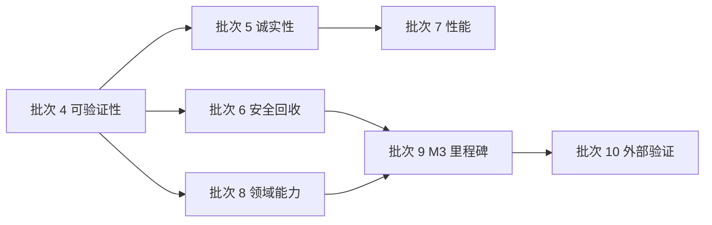

# 待实现功能 · 按批次划分（2026-11-07）

> 这是**唯一的排期入口**。每个 D-xxx / OPT-xx / T-xxx 编号仍以各自台账为准，这里只回答三件事：
> 哪些还没做、为什么现在做或不做、做完怎么验收。
>
> 事实源：
> - 缺陷与缺口：`docs/ledgers/deferred-issues.md`（D-xxx，227 条，含触发条件）
> - 44 项审计与落地对照：`docs/ledgers/optimization-and-new-features.md`（OPT-xx，§12 是最新状态）
> - 嵌入式子系统复查：`docs/ledgers/embedded-defects-todolist.md`（T-xxx，只剩 T-035 / T-040）
> - 检索层实验：`docs/ledgers/rag-vs-agentic-search-todo.md`（决策点 #2）
>
> **本文件不重复台账的描述**。要改某条的状态，改台账；要调排期，改这里。

---

## 0. 已完成的批次（不再排期）

| 批次 | 内容 | 证据 |
|---|---|---|
| 批次 1 | OPT-05/06/07/08/09：语料工具名对齐、Keil 证据诚实、停掉假排队与图片丢弃、设置页保存失败可见、发布链路自洽 | `optimization-and-new-features.md` §10；`e62675f` |
| 批次 2 | OPT-01/02/03/10/11：系统提示词 `environment` 节、整跑墙钟、MCP 会话级持有、连续截断上限、上下文超限恢复 | §12.1；`e62675f` |
| 批次 3 | OPT-04/15/18/19/20/27：artifact 只读工具与产物面板、进程内事件通道、`turn_progress` 工具名、evidence 筛选、Renode 固件装载、成本上限如实披露 | §12.1；`e62675f` |
| 批次 4 | OPT-25/26/28：文档按角色分目录、本地链接检查进 CI、统一 `verify`、覆盖率按实测收窄后纳入 `mcp-servers/{kb,datasheet,probe}`、台账状态自洽守护、T-035 断言 | 本文件批次 4 节；`99a319f` |
| 批次 5 | OPT-22/37/39、D-184/185/221：Datasheet 三处截断披露、续聊提示词冲突给人话、设置页草稿守卫（顺带修掉「确认框画在模态页后面」）、`@` 搜索返回目录、死 UI 清理、串口三处未接 | `dev-notes/批次5-诚实性.md` |
| 批次 6 | D-113/116/147/225、OPT-13/34/40：MCP 进程树回收（含终止时延 890 ms → 3 ms）、外链白名单与导航守卫、长任务超时出口、并发只读残留披露、权限层显式二选一、审批摘要脱敏 | `dev-notes/批次6-安全与资源回收.md`；`5d42e38` |

---

## 批次 4 · 文档与工程可验证性（本轮，成本最低）

**为什么最先**：这一批不改变产品行为，但后面每一批都靠它来「证明自己做完了」。当前最大的风险不是缺功能，而是**文档与实现会静默漂移**——2026-11-07 的核对就发现 7 处状态行落后于正文，而没有任何测试会因此变红。

| # | 项 | 来源 | 验收 |
|---|---|---|---|
| 4.1 | 文档按角色分目录（`specs/` / `operations/` / `ledgers/` / `archive/`），全仓引用同步 | OPT-28 的延伸 | `npm run check:docs` 0 失败 |
| 4.2 | 本地链接检查进 CI | 新增 | quick job 含 `check:docs`；故意写坏一条链接能让 CI 红 |
| 4.3 | 统一 `verify` 命令（typecheck + check:js + check:docs + test） | OPT-25 | `npm run verify` 一条命令跑完四项 |
| ~~4.4~~ | ~~覆盖率纳入 `mcp-servers/**`~~ **已落地（按实测收窄）** | OPT-26 | `coverage.include` = `src/**` + `kb` / `datasheet` / `probe`，`exclude` = `**/tests/**`；阈值仍 85%，实测 90.15% |
| ~~4.5~~ | ~~`git blame` 之外的状态守护：台账状态行抽检脚本（可选）~~ **已落地** | 新（2026-11-07 核对教训） | `npm run check:ledgers`：查两类**台账内部**矛盾——① 顶部复核注记写了已解决/已作废/已失效/已把决定用断言钉住，而 `- **状态**:` 仍以未解决/仍未解决/待修开头；② 同一条状态块内前后判词相反。只读台账文字，**不读代码**，绿 ≠ 状态准确（见 `dev-notes/M2-测试与CI优化.md`） |
| ~~4.6~~ | ~~T-035 的断言（`dropped` 用赋值不用累加）~~ **已落地** | T-035 | `tests/desktop/serial-dropped.test.js`：切出 `serial_lines` 分支，断言唯一写入是 `=`，排除 `+=` 与 `x = x + msg.dropped` |

> [!NOTE]
> 4.1 / 4.2 / 4.3 / 4.4 / 4.5 / 4.6 已在 2026-11-07 完成。4.5 的守护**只覆盖台账内部一致性**：它抓不到「状态行 vs 代码」的矛盾（2026-11-07 手工审计里的 D-134 / D-149 / D-189 / D-221 就是这一类），那需要读 `src/` 与 `desktop/`，仍是人工审计的范围。

**4.4 的实测数据（2026-11-07，`npm run coverage` 真跑）**

| 口径 | 行覆盖 | 对 85% 闸门 |
|---|---:|---|
| `src/**` 现状 | 90.99%（6837/7514） | 通过 |
| `src/**` + 全部 `mcp-servers/**` | 78.43%（9979/12722） | **失败**，还差约 835 行 |
| `src/**` + `kb` / `datasheet` / `probe` | **90.15%（8778/9737）** | 通过 |

领域层各模块行覆盖（排除 `**/tests/**` 后）：`kb` 91.30%（714/782）、`datasheet` 93.18%（437/469）、`probe` 81.28%（790/972）、`keil` 42.65%（1144/2682）、`serial` 19.45%（57/293）、`embedded` 0%（0/10）。

**定案口径**：闸门覆盖 `src/**` + `kb` / `datasheet` / `probe`，排除 `keil` / `serial` / `embedded`。理由不是"它们没测"，而是**剩余路径必须插着硬件才能走**：`mcp-servers/keil` 的 8721 行源码里，`keilSession` 要连真实 uVision 的 UVSOCK（端口 4823）；`serial/tools.ts` 的测试刻意不 spawn 泵、不碰真实 COM 口（`embed-serial.test.ts` 头注释写明）。把这两块算进闸门，等于要求离线测试覆盖真机路径——只能靠豁免或造假达成，两者都比不设闸门更糟。

> [!WARNING]
> **keil / serial / embedded 的覆盖率不设闸门，不代表它们被验证过。** 这一块的真实缺口登记在 `docs/ledgers/deferred-issues.md` 的 D-157（真机未实测）；在 D-157 关闭前，任何关于「Keil / 串口链路覆盖率」的说法都必须附带这个前提，不得只报领域层总数字。

---

## 批次 5 · 诚实性与小缺陷（用户直接撞得到的）

**为什么排第二**：这些都是 R3（工具必须诚实）的直接违约，改动小、用户可见，且不牵动架构。

| # | 项 | 来源 | 验收 |
|---|---|---|---|
| ~~5.1~~ | ~~Datasheet 三处静默截断披露~~ **已落地** | OPT-22 | `count` / `truncated` / `scanTruncated` 三字段；深度截停也置位；各场景有断言 |
| 5.2 | `system_prompt_mismatch` 的人话出路（宿主识别错误码，解释「旧会话不能补提示词」） | D-221 建议 ② | 旧会话 + `systemPrompt` 时报中文可读原因，不是英文原文 |
| ~~5.3~~ | ~~设置页 Esc / 遮罩丢未保存草稿~~ **已落地** | OPT-39 | `requestClose()` 三条关闭路径共用：无草稿直接关（不弹确认），有草稿走 `confirmAction`；确认框改为模态 `<dialog>`（原先画在 `showModal()` 的设置页后面）；`tests/desktop/settings-draft-guard.test.js` 7 例 |
| ~~5.4~~ | ~~`@` 搜索的两处限制~~ **已落地** | D-184 | 目录进结果（`kind: "dir"`，不占扫描预算）；`unavailable: true` 随每条应答下发 |
| ~~5.5~~ | ~~死 UI 清理：goals / subagents / 检查点~~ **已落地** | D-185 / OPT-38 | 复核后确认两端零生产者，整块删除（8 个事件分支 + 5 个函数 + 7 个 DOM 节点 + 62 个 i18n 键 + 343 行 CSS）；`tests/desktop/dead-ui-goals-subagents-checkpoints.test.js` 7 例 |
| ~~5.6~~ | ~~串口三个未接~~ **已落地** | OPT-37 | ① 面板裁行单独计数并显示（`droppedLocal`），不并进宿主的 `dropped`；② 打开时波特率选择不再禁用，改变即发 `serialBaud`（宿主 `mode:"reconfigured"` 保留会话）；③ `forkSession` 透传 `atSeq`，上界交给内核 |

---

## 批次 6 · 安全与资源回收

**为什么会成为独立批次**：这一批涉及进程、路径与权限边界，改动牵一发动全身，需要单独的设计与回归。

| # | 项 | 来源 | 验收 |
|---|---|---|---|
| ~~6.1~~ | ~~MCP 正常关闭回收整个进程树~~ **已落地**（`b21717a` + `09f19ff`） | D-225 | `reapProcessTree` 在收父进程前起 `taskkill /T /F`，只等 spawn（8–28 ms），不等 exit；未能确认时发 `dispose_incomplete`。**两处如实上报的边界**：POSIX 上 SDK 不透传 `detached`，进程组不可用；`detached` 后代仍收不到（有显式断言钉住）。台账里「顺序不可省」的因果被证伪，真正的变量是 detached |
| ~~6.2~~ | ~~Electron `will-navigate` 守卫 + `openExternal` 白名单~~ **已落地**（`95f2b55`） | OPT-40 | `desktop/link-policy.js` 纯函数判定：外链只放行 http/https 且 hostname 非空；导航只放行回到 index.html 自己（`path.relative` 判定）。38 例测试 |
| ~~6.3~~ | ~~长任务超时出口~~ **已落地**（`b21717a`） | OPT-13 | 硬顶 120s → 600s，默认仍 15s；`ToolDef.callTimeoutMs` 让工具抬高地板，用户显式配置更优先；种子里 keil 单独 600s。**注意挡路的是两道 120s**，管线层先触发 |
| ~~6.4~~ | ~~并发只读分支的残留执行披露~~ **已落地**（`e96fb4c`） | OPT-34 | 并发分支没有「后续调用」可跳（`Promise.all` 已全部启动），验收改成**披露**：超时后仍在跑的调用带 `detail.mayStillBeRunning: true` |
| ~~6.5~~ | ~~`executeBatch` / `query` 绕过权限层的防护~~ **已落地**（`d3133f7`） | D-116 | 权限语义必须显式二选一（`permission` 或 `unsafeSkipPermission: true`），类型层互斥 + 入口运行时守卫。**不是**「直接调用也走权限层」——unsafe 分支本来就不走 |
| ~~6.6~~ | ~~审批摘要的敏感片段~~ **已落地**（`eab3966`） | D-113 / D-147 | 键名切词后三档判定，敏感值换成 `[redacted:<类型>[:<规模>]]`；`paramsDigest` 与 `paramsKeys` 不变。真实工具面 31 个参数名误伤 0 |

> [!WARNING]
> **6.1 的两条残余不是「已完成」的一部分**：`detached` 后代在 `close()` 之后仍会存活，POSIX 下列表回收做不到。两者都有**显式断言**（不是注释里的一句「已知限制」），所以将来修好时测试会红、提醒改断言。真正的修法是把回收放到 transport 构造处（Job Object），比 taskkill 的 1 s 启动开销更早。

---

## 批次 7 · 性能与规模（有实测触发才做）

**触发条件**：出现真实长会话、大日志或慢客户端反馈。没有触发就不做——这些改动当前没有数据支撑。

| # | 项 | 来源 | 触发 |
|---|---|---|---|
| 7.1 | 会话列表与标题懒读（`titleOf` 读整份日志） | OPT-16 | 会话数 ≥ 数百时列表变慢 |
| 7.2 | 每条事件 fsync + 每轮多次全量投影 | OPT-31 | 长回合明显卡顿 |
| 7.3 | `grep` 先收集全部命中再排序截断 | D-078 | 大工作区 grep 超时 |
| 7.4 | `grep` / `glob` 的 ReDoS（同步正则阻塞事件循环） | D-085 / D-086 | 出现恶意或病态正则 |
| 7.5 | 压缩质量的六个观察项 | D-091~D-098 | 有真实长会话的 usage 数据 |
| 7.6 | 预算与占用率计入 tool schemas | OPT-12 | 需要先定「schema 怎么算 token」的口径 |

---

## 批次 8 · 领域能力补齐

| # | 项 | 来源 | 验收 |
|---|---|---|---|
| 8.1 | Keil 整镜像回读（按 `0x2000` 分段循环，`scope` 增 `segmented-full`） | D-223 | 大于 8192 字节的镜像能全量校验 |
| 8.2 | Keil 结构化构建诊断（`文件:行号`，而不是 UV4 日志原文） | D-200 | 编译错误能直接定位 |
| 8.3 | Keil 工具面读写分拆（`keil_debug` 按动作标注注解） | OPT-21 | 只读动作不再标 `destructiveHint` |
| 8.4 | KB 拒答扩展到 `kb_grep` / `kb_glob`，并重测拒答率 | D-179 / D-159 | 负样本拒答率有实测数字 |
| 8.5 | 错误码词表、`kb_search` 的 count/truncated、serial 权限模板、embedded 模板错名 | OPT-43 | 各自的断言 |
| 8.6 | 整片擦除能力（非 ST 芯片走厂商 CLI，或明确只支持 STM32） | D-201 | 能力报告如实，或补齐实现 |

---

## 批次 9 · M3 里程碑剩余（BRD §12）

**这批是「里程碑缺口」，不是可选优化**。完成前不能宣称 M3 达成。

| # | 项 | 来源 | 验收 |
|---|---|---|---|
| 9.1 | BR-7 夜批管线：夹具格式 + 幂等 + 整跑超时 + exit code 表 | OPT-44 / BRD BR-7 | 无人值守跑通一批；失败可判 |
| 9.2 | BR-6 会话回放控件（当前只做到「从日志重建转录」） | BRD BR-6 | 能按事件下标截断并回放 |
| 9.3 | 设备面板形态决策（面板还是工具行）——先决策再实现 | D-193 的后续 | 有决策记录；不复活 `getBoardState` |
| 9.4 | 子代理 / hooks / 工具 trace | 框架 #13 / #17 | 按需，需先有 spec |

---

## 批次 10 · 外部验证（需要环境，不是代码缺陷）

| # | 项 | 来源 | 前置 |
|---|---|---|---|
| 10.1 | live 网关三 env、真实第三方 MCP、真机串口与 OpenOCD | D-111 / D-157 | 需要板卡与网关 |
| 10.2 | Renode 1.16 的 `sysbus LoadELF` 成败文案、`pause` 在已暂停机器上的行为 | OPT-20 待验证 | 需要真实 Renode |
| 10.3 | 一次真实的应用内更新（装 v0.1.5 → 收到 v0.2.0 → 下载安装） | D-212 残余 | 需要干净机器 |
| 10.4 | Windows 代码签名验证 | D-211 | 需要证书 |
| 10.5 | 打包契约 §9：asar 内 ESM 动态 import、junction 在 `%LOCALAPPDATA%` | `docs/operations/release.md` | 需要打包环境 |

---

## 明确不做 / 触发式（审计已判定，不再列入排期）

| 项 | 判定 | 依据 |
|---|---|---|
| MCP HTTP transport（D-190） | 不提升 | 五台领域 server 全是本地进程；引入鉴权面成本 M |
| in-process 工具 worker 隔离（D-109） | 不提升 | 当前无第三方 in-process 工具 |
| shell 黑名单绕过（D-083 / D-087 / D-088） | 不做 | 黑名单不是安全边界，由权限层兜底 |
| 压缩质量六项（D-091~D-098） | 触发式 | 见批次 7 |
| `verify_register_write`（datasheet D16） | 不做 | spike 结论：启发式解析假阳性会误导用户 |
| Ontology 纳入检索比对 | 暂缓 | `docs/specs/ontology-scope-note.md` 的重启条件 |
| 多 gold 标注 / 扰动集 H6 / 10x 规模验证 | 待定 | 决策点 #2 未关闭，但当前无排期 |

---

## 批次依赖

**批次 4 是所有后续批次的前置**：没有 `verify` 与链接/文档守护，后面每一批的「已完成」都无法被独立复核。

---

## 维护规则

1. **只在开头改排期，不在正文改状态**。状态以台账为准，本文只引用编号。
2. **一条做完**：在对应批次表里划掉，并在「已完成的批次」表补一行（含提交哈希）。
3. **新增待办**：先登记台账（D-xxx / OPT-xx / T-xxx），再决定放进哪一批；不要直接在本文里发明编号。
4. **批次 10 的项不阻塞其他批次**：它们需要外部环境，可以与其他批次并行等待。
