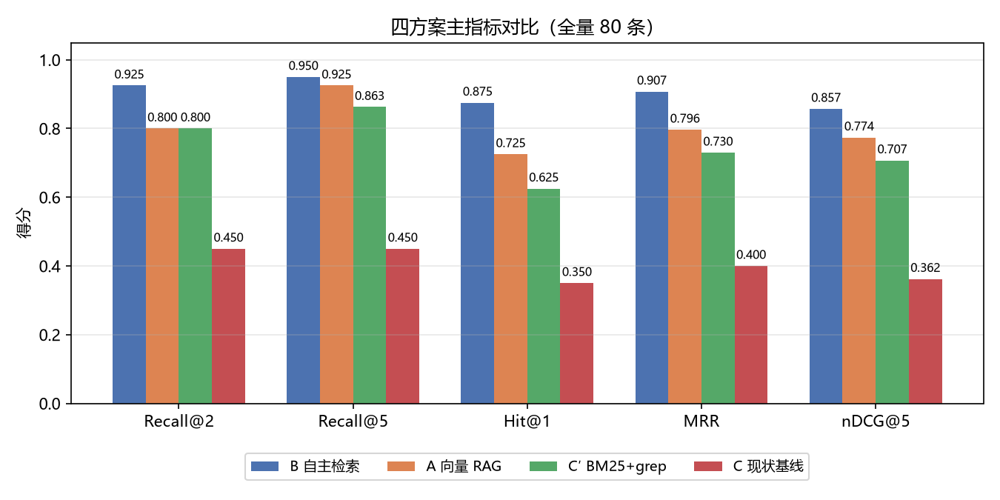
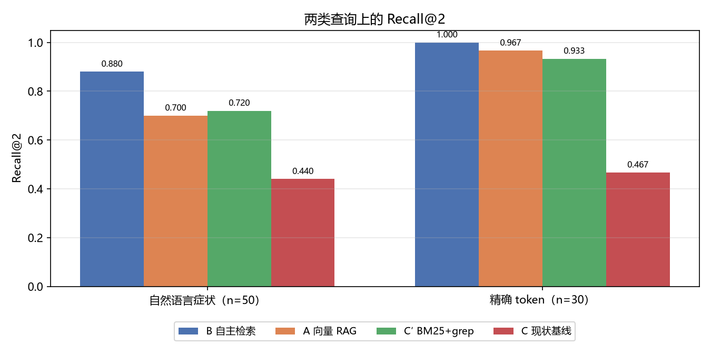
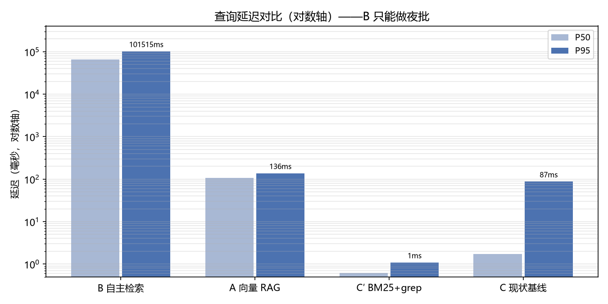
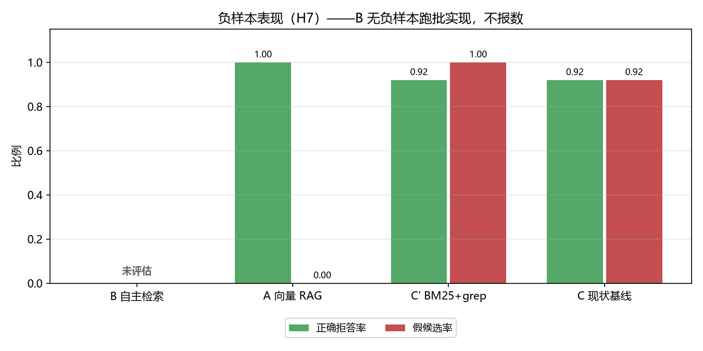
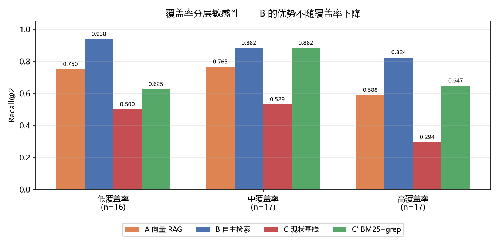

# RAG vs Agentic Search 对照实验 · 汇总报告

> **状态：探索性（exploratory）。预注册未冻结，本报告不构成主判定依据**（spec T2）。
> 决策点 #2（KB 渐进加载的载体）**尚未关闭**——本轮只确定了方向。
> 完整报告（含全部数字、偏差披露、复现命令）：[`experiments/rag-vs-agentic-search/docs/experiment-report.md`](../../experiments/rag-vs-agentic-search/docs/experiment-report.md)

**实验**：在嵌入式调试知识库（108 个 markdown 文件）上，用同一批 80 条查询、同一套
判定口径，比较四种检索方案。语料快照带 SHA-256 校验，各方案看到同一份世界。

---

## 1. 结论速览

| 方案 | Recall@2 | Hit@1 | MRR | nDCG@5 | P50 | P95 | 失败率 |
|---|---|---|---|---|---|---|---|
| **B** Agentic 自主检索 | **0.9250** | **0.8750** | **0.9073** | **0.8570** | 65.0 s | 101.5 s | 2.5% |
| A 向量 RAG | 0.8000 | 0.7250 | 0.7965 | 0.7736 | 106 ms | 136 ms | 0% |
| C′ BM25 + grep | 0.8000 | 0.6250 | 0.7296 | 0.7070 | **0.62 ms** | **1.08 ms** | 0% |
| C 现状基线（kb_lookup + grep） | 0.4500 | 0.3500 | 0.4000 | 0.3621 | 1.7 ms | 87 ms | 15% |

**三条结论：**

1. **维持无 RAG，KB 渐进加载走 C′（BM25 + grep）**，C 保留为兜底。
2. **不引入向量召回层。** 理由不是「A 没赢稀疏方案」，而是「**agentic 检索显著优于向量检索**」：
   B 比 A 高 12.5pp（p_adj = 0.039，95% CI [−21.2, −3.8]pp）。
   **若要给检索层加投入，方向是 agentic 而非向量。**
3. **B 只能做夜批/离线**（P95 101.5 秒）；**C′ 是唯一的交互链路方案**（1.08 ms，Recall@2 与 A 打平）。

---

## 2. 显著性（预注册比较族 + Holm 校正）

族大小**固定为 4**，缺席项按 p = 1 计入——缺数据不会让校正系数变松。

| 比较 | 差值 | McNemar | p (Holm) | 95% CI | 显著 |
|---|---|---|---|---|---|
| **A vs B** | −12.5pp | 2/12 | **3.9e−02** | [−21.2, −3.8]pp | **是** |
| **C′ vs C** | +35.0pp | 30/2 | **9.9e−07** | [+23.8, +46.2]pp | **是** |
| A vs C′ | +0.0pp | 6/6 | 1.00 | [−8.8, +8.8]pp | 否 |
| D vs 最优单一方案（B） | — | — | — | — | 跳过（D 无全量数据） |

配对 McNemar 精确检验 + 配对 bootstrap（10,000 次，按 track 分层）。

---

## 3. 两类查询上的差异

| 方案 | index 轨（自然语言症状，n=50） | search 轨（精确 token，n=30） |
|---|---|---|
| B | **0.880** | **1.000** |
| A | 0.700 | 0.967 |
| C′ | 0.720 | 0.933 |
| C | 0.440 | 0.467 |

**B 在两轨上都是第一，没有短板。** B 赢 A 的 12 条**全部落在自然语言症状查询上**
（uart、spi、emi、hardfault、vendor、rtos 六类），且 A 在这些条目上 `status = ok`
——是**真的没召回**，不是报了错。

---

## 4. 延迟与部署形态

| 方案 | P50 | P95 | 判定 |
|---|---|---|---|
| C′ | 0.62 ms | 1.08 ms | ✅ 可进交互链路 |
| A | 106 ms | 136 ms | ✅ 可进交互链路 |
| C | 1.7 ms | 87 ms | ✅ 可进交互链路 |
| **B** | **65.0 s** | **101.5 s** | ⚠️ **只能做夜批/离线** |

B 每条查询约 1.9 万输入 token、6 轮工具调用。**它是效果最好的，但也是唯一不能进交互链路的。**

---

## 5. 负样本表现（H7）——最大的未知

| 方案 | 正确拒答率 | 假候选率 |
|---|---|---|
| A | 1.00 | 0.00 |
| C′ | 0.08 | **0.92** |
| C | 0.08 | **0.92** |
| **B** | **未评估** | **未评估** |

- **C′ 与 C 的假候选率 92%**：`kb_search` 遍历全部文件，`_sources.md` 恒排第一。
  这不是 kb-mcp 的回归缺陷（它自己的回归只测 lookup），但意味着**部署形态的拒答能力远低于表观数字**。
- **B 整块不报**：B 没有负样本跑批实现。**「没跑过」和「跑出来满分」在报告里长得一模一样**——
  上一轮就踩过这个坑（曾把 B 算成「正确拒答率 100%」）。现在 B 明确标「未评估」。

---

## 6. B 的优势不是评测集同源红利

威胁：评测集与语料同一人所写 → 词频匹配方案可能吃「用词重合」的红利。
做法：按「查询 token 在语料词表里的覆盖率」把 50 条 index 查询分三层，比较各层上各方案相对 A 的 Recall@2 差距。

| 层 | n | B 相对 A | C′ 相对 A |
|---|---|---|---|
| 低覆盖率 | 16 | **+18.8pp** | −12.5pp |
| 中覆盖率 | 17 | +11.8pp | +11.8pp |
| 高覆盖率 | 17 | **+23.5pp** | +5.9pp |

**B 的优势不随覆盖率下降**（相关系数 −0.018），**C′ 恰恰相反**（低覆盖层塌下来 −12.5pp，
高覆盖层才转正 +5.9pp，相关系数 +0.144）。**对照组呈现了典型的红利形态，说明这个方法确实测得出这类偏差**，
B 的「不塌」才是有意义的证据。

---

## 7. 决策表逐条判定

| 决策条件 | 判定 | 依据 |
|---|---|---|
| B/C/C′ 均不劣于 A → 维持无 RAG | ⚠️ **部分成立** | B 两轨都不劣于 A（index +18.0pp / search +3.3pp）；但 C 明显劣于 A（−26.0pp / −50.0pp），C′ 的 search 轨 Hit@1 也劣于 A（0.7333 vs 0.9667）。**字面表述是「三者都不劣于 A」，故字面不成立**；其意图由 B 单独达成 |
| A 在自然语言查询领先最优稀疏 ≥ 10pp → 引入向量召回层 | ❌ **不成立** | A 的 index 轨 0.700 **低于** C′ 的 0.720，A 未领先 |
| C′ 较 C 提升 ≥ 5pp 且无 RAG 依赖 → C′ 成默认，C 兜底 | ✅ **成立** | +35.0pp，p_adj = 9.9e−07 |
| 任一方案 P95 > 3s → 只做夜批 | ✅ **B 触发** | B P95 101.5 秒 |
| H7 最优方案假候选率 > 20% → 必须加拒答通道 | ✅ **对 C′ 成立** | C′ 假候选率 92%；A 为 0%；**B 无法评估** |
| H3 规模阈值 | ⚠️ 未做 | 规模实验为可选阶段 |

---

## 8. 必须一并引用的偏差

1. **预注册未冻结**（`PREREGISTRATION.md` 的本文件哈希仍是占位符）→ 全部结果为 exploratory，
   `score --confirmatory` 拒绝执行。
2. **单标注者**：查询、gold、多 gold 补标均由同一人编写，无一致性系数（spec §6.5）。
   nDCG@5 因此标低置信。
3. **样本量 80 条**，低于 spec 功效估算所依据的 274 条（原回归集确认无法取得）。
   10pp 效应下检验功效显著下降，结论更可能落入「未决」。
4. **11/80 条的 gold 不在 `index.yaml` 中** → C 的 lookup 分支结构性无法命中，
   该层实测 Recall@2 = 0.0909，须分层报告。
5. **nDCG@5 用的是多 gold 标注**（50/50 条 index 查询覆盖，平均 1.94 个 gold/条）。
   **只影响 nDCG@5**——Recall/Hit/MRR 一律用原始单 gold（spec §7.3 第 5 条）。
   接线前后主判定指标**一字未变**，nDCG 排序不变。
6. **两次跑批不在同一时间窗**（B 于 2026-10-21 跑，A/C/C′ 于 2026-10-20 跑），
   网关负载不同，**绝对延迟不可跨方案直接相减**。
7. **B 的全量 80 条是单次运行的点估计**：稳定性只在 10 条子样本上量化过
   （R@2 区间 [90%, 100%]、失败率 [0%, 10%]），把区间套到全量需一个未验证的假设。

---

## 9. 关闭决策点 #2 之前仍缺

| 缺口 | 影响 | 成本 |
|---|---|---|
| **B 的 H7 无法评估** | 「KB 外查询会不会被瞎猜」未答——B 进生产链路的前置条件 | 约半天 |
| **B 在全量上的波动区间未知** | 稳定性只在 10 条子样本上量化过 | 重跑全量 3 次（约 5.4 小时） |
| **独立盲写查询** | 现有 20 条是同一人换措辞，不是独立标注 | 依赖他人 |
| **第二位标注者** | 多 gold 仍是单人标注，nDCG@5 低置信 | 依赖他人 |
| **预注册冻结** | 本文件哈希未算 → 无法跑确认性评测 | 依赖上面几项 |

**因此本轮只关闭了「方向」，没有关闭「决策点 #2」。**
按 spec §6.1 的显著性要求与 T2 门禁，确认性结论须在预注册冻结后重跑。

---

## 10. 产物

- **完整报告**：[`experiments/rag-vs-agentic-search/docs/experiment-report.md`](../../experiments/rag-vs-agentic-search/docs/experiment-report.md)
- **实验代码**：`experiments/rag-vs-agentic-search/src/raglab/`
- **逐查询评分与汇总**：`experiments/rag-vs-agentic-search/results/scored/main/`
- **统计与图表数据**：`experiments/rag-vs-agentic-search/results/tables/`、`results/analysis/`
- **预注册**：`experiments/rag-vs-agentic-search/PREREGISTRATION.md`
- **复现**：`raglab import` → `split` → `index` → `grid --write-resolved` → `run` → `score` → `analyze` → `sensitivity --from-runs`

> **图注**：本目录的 5 张图由汇总数据重新绘制（`results/scored/main/summary.json`、
> `results/analysis/main.json`、`results/tables/sensitivity_coverage_all.json`），
> 与实验仓库内 `results/diagnostic/c-diag/figures/` 的 4 张单方案诊断图**不是同一组**——
> 后者是 C 一个方案的诊断，已复制到 [`figures-c-diag/`](figures-c-diag/) 并附说明。
