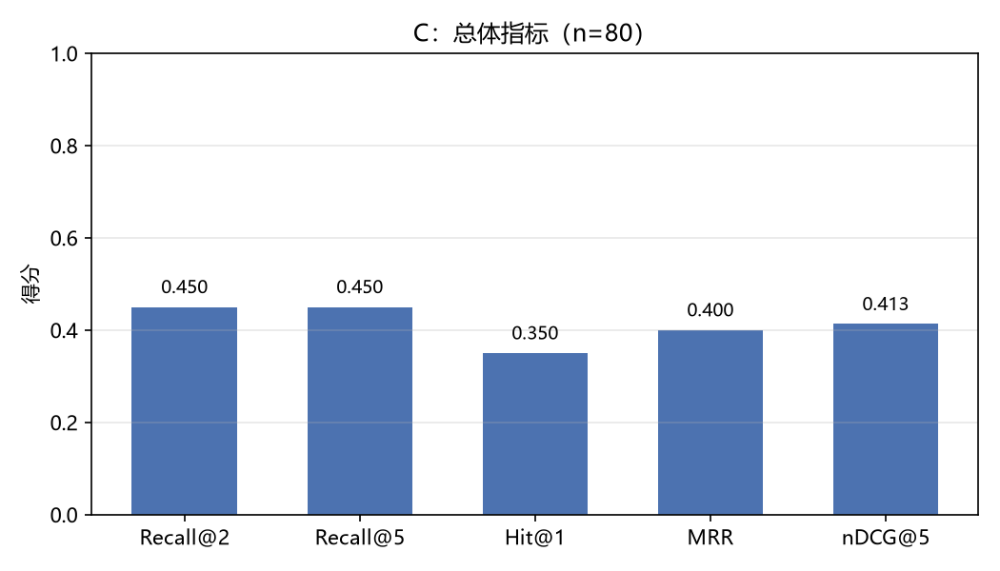
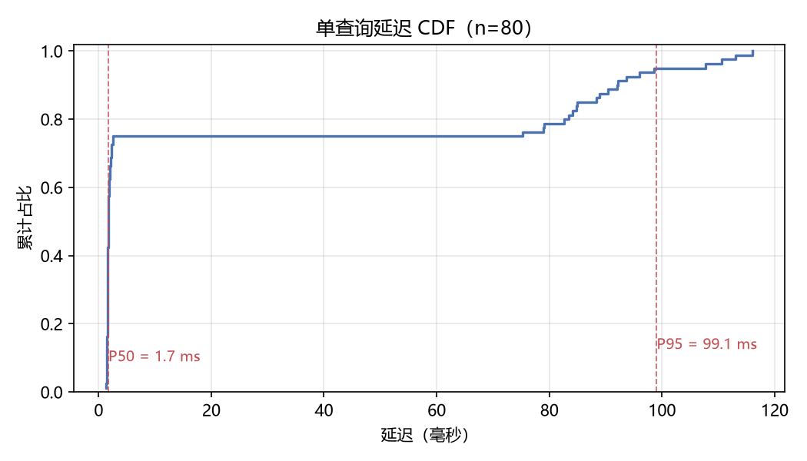
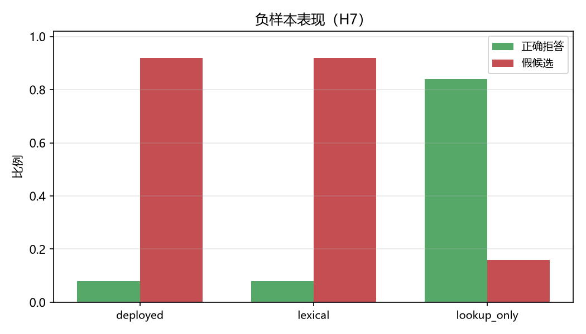
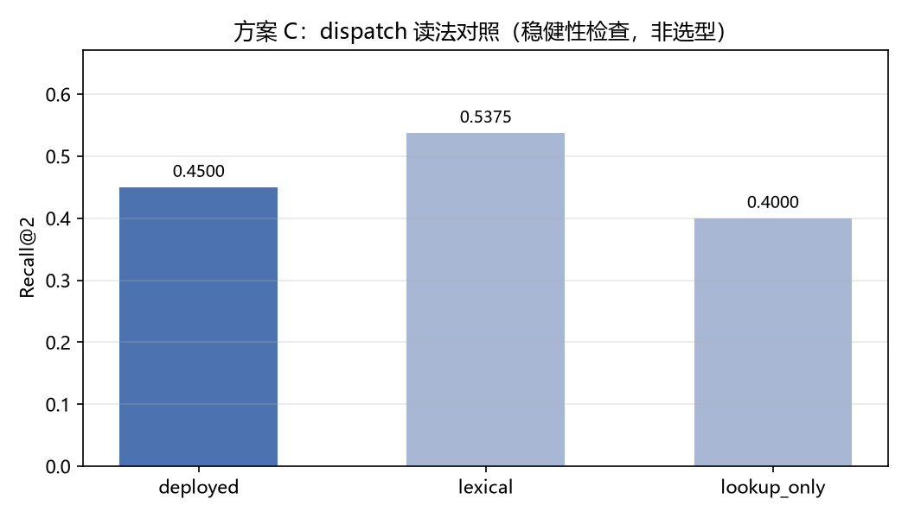

# 方案 C 诊断报告（探索性）：`c-diag`

> **这不是实验结论。** 当前只有方案 C 可以运行，本报告是**探索性诊断**：
> 它回答「这套 C 的实现到底在做什么」，不回答「哪个方案更好」。
> 只有一个方案时，任何数字都不得被读成方案对比，也不得据此声称谁胜出（spec T2 / T3）。

## 1. 跑的是什么

- **方案**：C（现状基线 = `kb_lookup` 索引路由 + `kb_search` 精确 token grep）
- **实现方式**：对主仓库 `mcp-servers/kb/`（`feat/m2-stage3` @ `c529dcd`）做逐行移植，用 105 条查询（80 正 + 25 负）与 kb-mcp 原件逐条比对，lookup / token 提取 / search 三项**零差异**
- **语料**：`corpus/kb/` 共 108 个 markdown 文件，90 条索引条目
- **查询**：全量 80 条（不分 dev/test，不参与调参）
- **负样本**：25 条
- **运行模式**：`exploratory`

## 2. 主指标

三种 dispatch 读法的完整对照。**主口径是 `deployed`**（预注册 §6bis）：它对应真实部署的系统；另两种要改写 kb-mcp 的闸门或删掉回退逻辑，是构想出来的变体。

| dispatch 读法 | 主口径 | n | Recall@2 | Recall@5 | Hit@1 | MRR | nDCG@5 | P50 (ms) | P95 (ms) |
|---|---|---|---|---|---|---|---|---|---|
| deployed | ★ 主口径 | 80 | 0.4500 | 0.4500 | 0.3500 | 0.4000 | 0.4131 | 1.7258 | 99.0558 |
| lexical |  | 80 | 0.5375 | 0.5375 | 0.3375 | 0.4375 | 0.4637 | 4.3588 | 6.9077 |
| lookup_only |  | 80 | 0.4000 | 0.4000 | 0.3250 | 0.3625 | 0.3723 | 5.3352 | 6.7973 |

> `deployed` 与 `lexical` 差 8.75pp、与 `lookup_only` 差 5pp，**跨度超过本实验主判定用的 5pp 门槛**。这正是预注册 §6bis 要求「三种读法全部报告」的原因：只看一种读法得出的结论，换一种读法可能反向。**若后续与 C′/A/B 的对照在三种读法下方向不一致，C 相关判定一律写「未决（口径敏感）」。**

## 3. 负样本行为（H7）

**这一节最容易被误读**：kb-mcp 自报的 0.84 拒答率是**只调 `lookup`** 的数字。按 `deployed` 形态回退到 `kb_search` 后，正确拒答率降到 0.08。两个数字都对，但指的是不同的系统。

| dispatch 读法 | 负样本数 | 正确拒答率 | 假候选率 |
|---|---|---|---|
| deployed | 25 | 0.0800 | 0.9200 |
| lexical | 25 | 0.0800 | 0.9200 |
| lookup_only | 25 | 0.8400 | 0.1600 |

> 原因：`kb_search` 遍历全部 `.md` 文件，`_sources.md` 会命中几乎所有查询且按路径字典序恒排第一。这不是 kb-mcp 的回归缺陷（它自己的回归脚本只测 lookup），但意味着**部署形态的拒答能力远低于单独 lookup 的表观数字**。

## 4. 图

**跳过的图及原因**（不产出空图——空图会被读成「无差异」）：

| 文件 | 原因 |
|---|---|
| fig1_recall_by_type.png | 仅有 1 个方案可跑，对比图无意义（不得以单方案冒充对比） |
| fig4_cost_quality.png | 仅有 1 个方案可跑，对比图无意义（不得以单方案冒充对比） |
| fig8_domain_heatmap.png | 仅有 1 个方案可跑，对比图无意义（不得以单方案冒充对比） |
| fig5_perturbation_decay.png | 扰动集未建（H6 已按 §5.2 降级） |
| fig7_scale_recall.png | 规模实验（H3）为可选阶段，未运行 |

## 5. 已知偏离（必须随本报告一起引用）

- **单标注者**：80 条查询全部由项目所有者编写，无一致性系数（spec §6.5）。
- **样本量 80 < 原设计 274**：原回归集确认无法取得，已换自建集；功效下降，10pp 效应更可能被判「未决」。
- **11/80 条 gold 不在 `index.yaml` 中**：方案 C 的 `lookup` 分支在这些查询上无法命中；分层的实测 Recall@2 是 0.0909（1/11），不是 0——唯一命中来自 search 分支。
- **扰动集与多 gold 未建**：H6 已按 §5.2 降级为 warning，nDCG@5 按单 gold 计。

## 6. 运行期告警

- 延迟在索引预加载后测量；不含 `index.yaml` 解析成本（该成本每进程只付一次）
- deployed 读法下 30/80 条查询回退到 search；该读法隐含「agent 见 found=false 就换工具」的假设（预注册 §6bis）

## 7. 这份报告不能回答什么

- **不能**回答「C 好还是 C′/A/B 好」——只有 C 一个方案，没有任何对比。
- **不能**回答「要不要上 RAG」——那是决策点 #2，需要五个方案跑完。
- **不能**作为冻结配置的依据——预注册尚未冻结，本报告不参与任何选择。

